  

# JackStar

### Systems Architect · AI Infrastructure Pioneer · High-Concurrency Engineer

[Portfolio (jack.drakescraft.cl)](https://jack.drakescraft.cl) ·
[OmniAST](https://github.com/JackStar6677-1/omniast) ·
[Slimefun: New Horizons](https://github.com/SlimefunNewHorizons) ·
[DrakesCraft](https://web.drakescraft.cl) ·
[YouTube Stream 24/7](https://www.youtube.com/@jackstar6677)

---

> [!NOTE]
> **Language Note:** My native language is Spanish, but I write and maintain this profile and my core technical repositories in English as the global standard for international software engineering, compiler design, and open-source collaboration.

I engineer, operate, and secure mission-critical infrastructure where software meets operational reality: high-throughput event loops, transactional ACID databases, institutional educational environments, bare-metal server clusters (**Star VPS, ccg-fisico dedicated, Nexus workstation**), intermediate graph compilers for autonomous AI swarms, and multi-model agent systems.

My engineering portfolio is organized into **three distinct, strictly isolated operational pillars**:

---

## 🏛️ The Three Pillars of Engineering

### 1. 🌌 Compilers, Graphs & Autonomous AI Ecosystems
My primary focus at the frontier of agentic artificial intelligence and token-efficient software design:
* **[OmniAST / GraphLang](https://github.com/JackStar6677-1/omniast):** Sovereign intermediate graph language and compiler kernel engineered for autonomous AI models (Google Antigravity, OpenAI Codex, Claude, DeepSeek, Grok). Provides deterministic transpilation to JVM (Java 21+ Paper), Native Rust (Panama FFI), Python Asyncio, TypeScript (Node.js/OpenClaw), and WebAssembly (WASM). Delivers an **85% reduction in token consumption** and eliminates context window collapse in massive enterprise codebases (100k+ files).
* **[SAORI 3.0.0-KOKORO](https://github.com/JackStar6677-1/saori) & Neural Observatory:** Omnichannel Site Reliability Engineering (SRE) framework coordinating a 5-model AI quintet (Claude 3.5 Sonnet, Codex 5.5, Gemini 3.8 Flash, DeepSeek OpenCode). Features an auditable Knowledge Lake (15,986 Slimefun items, 15,129 AST nodes), real-time Flight Recorder causal tracing, metacognition loops, and concurrent SQLite WAL leases.
* **OpenClaw & Hermes Integration:** Native Nous Hermes JSON schema tool generation, TypeScript omnichannel daemon gateway, and unified routing across Discord, WhatsApp, In-Game RCON, and live web dashboards.

### 2. 🐉 High-Concurrency Infrastructure & Game Engine Platforms
Systems engineering for distributed, high-throughput multiplayer game networks in production:
* **StarSuites Engine ([`Drakes-Suites`](https://github.com/SlimefunNewHorizons/Drakes-Suites)):** Large-scale modular monorepo modernizing and consolidating 190+ micro-addons into decoupled suites running on Paper/Purpur 26.x (JDK 25) with SQLite WAL persistence and hot-reloading modular configurations (`modules/*.yml`).
  > ℹ️ **Canonical Upstream Attribution:** Slimefun is an open-source work originally created by **TheBusyBiscuit** and the open-source community. My role is that of a **modernization and rescue systems architect**: porting to Paper 1.21.11+ / Purpur 26.x, eliminating ticker bottlenecks, implementing off-heap memory in Rust, and modular monorepo unification.
* **[Slimefun-Rust](https://github.com/SlimefunNewHorizons/Slimefun-Rust) & Odysseia-Rust:** Off-heap Rust acceleration engines using Project Panama (FFM API) for SIMD ticker computations and zero-garbage-collector industrial power grid balancing.
* **Season 2 (Paper 26.2 / Java 25):** 100% verified staging fleet (**190 plugins loaded and operational with 0 disabled plugins**, achieving 100% feature parity with production Dallas including Tebex, Geyser Bedrock crossplay, DiscordSRV, AuraSkills, Jobs, Teams, AxGraves, and Multiverse).
* **[DrakesCraft Network](https://web.drakescraft.cl) (Dallas, TX):** Distributed multiplayer network spanning **6 connected modalities (Slimefun, Clásico, SkyBlock, OneBlock, OneChunk, Laboratorio)**, featuring idempotent Tebex transaction verification, macro-economic integrity gates, and hardened forks ([**BentoBox-Drake**](https://github.com/SlimefunNewHorizons/BentoBox-Drake), [**CrazyAuctions-Drake**](https://github.com/SlimefunNewHorizons/CrazyAuctions-Drake), [**InvSwitcher-Drake**](https://github.com/SlimefunNewHorizons/InvSwitcher-Drake)).
* **Multiverse Suite (by Chagui68):** Official production integration of the Multiverse Suite (`drakes-multiverse.jar`), acknowledging the design and authorship of my collaborator **Chagui68** ([`MultiverseCreatures`](https://github.com/SlimefunNewHorizons/MultiverseCreatures) and [`MultiverseNets`](https://github.com/SlimefunNewHorizons/MultiverseNets)).

### 3. 🏫 Educational Technology & Institutional Infrastructure
Professional IT systems engineering and institutional campus administration:
* **Campus Networking & Infrastructure:** End-to-end administration of institutional networks, server rooms, hardware virtualization, computer laboratories, and workstation fleets.
* **Platforms & Web Portals:** Design, deployment, and maintenance of internal room reservation systems ([**CastelRoomKeeper**](https://github.com/JackStar6677-1/CastelRoomKeeper)), administrative portals, and institutional workflow automation.
* **Lab Automation & Preventative Monitoring:** Automated remote management scripts ([**VeyonScripts**](https://github.com/JackStar6677-1/VeyonScripts)), preventative infrastructure health monitors ([**CampusCare-Monitoring**](https://github.com/JackStar6677-1/CampusCare-Monitoring)), and credential workflows.

---

## 🛠️ Selected Projects

| Project | Focus & Engineering Role |
|---|---|
| [**OmniAST / GraphLang**](https://github.com/JackStar6677-1/omniast) | Universal graph-native kernel for AI agents, multi-target transpilation (JVM, Rust, TS, WASM), and 85% token reduction. |
| [**StarSuites**](https://github.com/SlimefunNewHorizons/Drakes-Suites) | Modular consolidation and modernization of 190+ addons for Purpur 26.x with SQLite WAL and Rust FFM. |
| [**SAORI Core & SRE Swarm**](https://github.com/JackStar6677-1/saori) | Autonomous SRE orchestrator with multi-account pools, automated failover, and multi-model AI triad (Antigravity / Codex / Claude). |
| [**Slimefun: New Horizons**](https://github.com/SlimefunNewHorizons) | Modernization ecosystem rescuing 190+ Slimefun repositories ported to modern Paper/Purpur architectures. |
| [**Slimefun-Rust**](https://github.com/SlimefunNewHorizons/Slimefun-Rust) | Off-heap Rust acceleration engine (Project Panama / FFM) for SIMD calculations with zero GC pauses. |
| [**CastelRoomKeeper**](https://github.com/JackStar6677-1/CastelRoomKeeper) | Institutional room booking and facilities management platform for educational campuses. |
| [**BentoBox-Drake**](https://github.com/SlimefunNewHorizons/BentoBox-Drake) | Hardened fork featuring safe Paper Data Component deserialization (Incident #276 fix). |
| [**VeyonScripts**](https://github.com/JackStar6677-1/VeyonScripts) | Remote management and automation suite for institutional computer laboratories. |

---

## ⚙️ Engineering Philosophy

I value software engineered to endure: reproducible deployments, rigorous observability, transactional data integrity, crystalline documentation, and end-to-end traceability. Technology exists to simplify reality, not complicate it.
