  

# JackStar

### Systems Architect · AI Infrastructure Pioneer · Hybrid Java × Rust Engine Engineer

[Portfolio (jack.drakescraft.cl)](https://jack.drakescraft.cl) ·
[SAORI Tactical](https://github.com/SlimefunNewHorizons/saori-tactical) ·
[OmniAST](https://github.com/JackStar6677-1/omniast) ·
[DrakesPurpur Engine](https://github.com/SlimefunNewHorizons/DrakesPurpur) ·
[DrakeStar Launcher](https://github.com/SlimefunNewHorizons/DrakeStar-Launcher) ·
[DrakesCraft Labs Org (200+ Repos)](https://github.com/SlimefunNewHorizons) ·
[DrakesCraft Network](https://web.drakescraft.cl) ·
[YouTube Stream 24/7](https://www.youtube.com/@jackstar6677) ·
[🇪🇸 README Extendido](./README.extendido.md)

---

> [!NOTE]
> **Language Note:** My native language is Spanish, but I write and maintain this profile and my core technical repositories in English as the global standard for international software engineering, compiler design, and open-source collaboration. An extended Spanish technical dossier is available in [`README.extendido.md`](./README.extendido.md).

I engineer, operate, and secure mission-critical infrastructure where software meets operational reality: hybrid Java × Rust server engines, cross-platform desktop launchers, high-throughput event loops, transactional ACID databases, institutional educational environments, bare-metal & cloud server clusters (**Star VPS, ccg-fisico dedicated, Nexus workstation, Nova workstation**), intermediate AST graph compilers for autonomous AI swarms, and multi-model agent systems.

My engineering portfolio is organized into **three distinct, strictly isolated operational pillars**:

---

## 🏛️ The Three Pillars of Engineering

### 1. 🌌 Compilers, Knowledge Graphs & Autonomous AI Ecosystems
My primary focus at the frontier of agentic artificial intelligence and token-efficient software design:
* **[OmniAST / GraphLang](https://github.com/JackStar6677-1/omniast) & `graphify` Suite:** Sovereign intermediate graph language, AST compiler kernel, and persistent knowledge-graph retriever engineered for autonomous AI models (Google Antigravity, OpenAI Codex, Anthropic Claude, NVIDIA Cloud NIM, DeepSeek). Provides deterministic transpilation to JVM (Java 25+ Paper/Purpur), Native Rust (Panama FFM), Python Asyncio, TypeScript, and WebAssembly (WASM), delivering an **85% reduction in token consumption** across Star and Nexus workstations.
* **[SAORI 3.0.0-KOKORO](https://github.com/JackStar6677-1/saori) & Neural Observatory:** Omnichannel Site Reliability Engineering (SRE) framework coordinating a multi-model AI swarm (Claude, Codex, Gemini/Antigravity, DeepSeek, and **NVIDIA Cloud NIM** LLMs & Riva voice synthesis). Features an auditable Knowledge Lake (15,986 Slimefun items, 15,129+ AST nodes), real-time Flight Recorder causal tracing, shared MCP memory (`ai_hub_memory`), and concurrent SQLite WAL leases.
* **Symmetric SRE Triad:** Coordinated multi-agent workflow pairing Google DeepMind (Antigravity), OpenAI (Codex), and Anthropic (Claude) for round-the-clock automated verification, benchmarking, and continuous deployment.

### 2. 🟣 High-Concurrency Engines, Desktop Launchers & Open-Source Ecosystems ([DrakesCraft Labs](https://github.com/SlimefunNewHorizons))
Founder and lead architect of **[Slimefun: New Horizons · DrakesCraft Labs](https://github.com/SlimefunNewHorizons)**—an open-source organization of **200+ repositories** that spans far beyond Slimefun into hybrid game engines, desktop launchers, standalone plugin suites, hardened open-source server forks, and Linux desktop engineering:
* **Project Purple — Unified Java × Rust Platform:**
  - **[DrakesPurpur 26.2](https://github.com/SlimefunNewHorizons/DrakesPurpur):** Sovereign Minecraft server engine fork of Purpur 26.2 (Java 25 LTS) with an embedded **Rust Panama FFM native engine (`native/drakes-hybrid`)**. Features versioned C-ABI with SHA-256 verification and automatic Java fallback, bit-exact `PalettedContainer` bit-packing & `NormalNoise` evaluation (verified across 13,872 NBT chunk containers and 600,000 noise points), **two-tier `P-promovido` directional chunk prefetch** (reducing high-speed flight late chunks from 28% to 18% and cutting `p95` latency from 1689 ms to 1301 ms), **`DrakesLOD` (`horizon:lod` v1 protocol + $O(1)$ multi-scale `HorizonLodCache`)**, Kernel Crash Guard (`drakes_faults.db`), SQLite WAL storage audit (`drakes_storage_audit.db`), and airtight **6-modality isolation**.
  - **[DrakeStar-Launcher](https://github.com/SlimefunNewHorizons/DrakeStar-Launcher):** Hybrid Java × Rust desktop launcher built with **Tauri 2 + Rust (`core`, `net`, `app`, `cli`) + Svelte 5 / TypeScript**. Supports `DrakesRust`, `DrakesJava`, `Local Forge` (local server lifecycle supervisor, live stdout/stderr streaming, interactive stdin console, EULA/`server.properties` editor, Slimefun preset installer, and one-click world backups), and `Online` (**Minecraft Server List Ping `0x00`** + TCP latency), backed by 51/51 Rust unit & integration tests across Windows and Linux.
* **Hardened Open-Source Server Forks (Standalone, Non-Slimefun):**
  Organization-maintained forks of major open-source server plugins modernized for Paper 1.21.11 & Purpur 26.2 (JDK 21/25) with anti-duplication locks and safe Data Component serialization: **[`BentoBox-Drake`](https://github.com/SlimefunNewHorizons/BentoBox-Drake)**, **[`InvSwitcher-Drake`](https://github.com/SlimefunNewHorizons/InvSwitcher-Drake)**, **[`PlayerVaultZ-Drake`](https://github.com/SlimefunNewHorizons/PlayerVaultZ-Drake)**, **[`CrazyAuctions`](https://github.com/SlimefunNewHorizons/CrazyAuctions)**, **[`sbank`](https://github.com/SlimefunNewHorizons/sbank)**, **[`LevelledMobs-Drake`](https://github.com/SlimefunNewHorizons/LevelledMobs-Drake)**, **[`WorldwideChat`](https://github.com/SlimefunNewHorizons/WorldwideChat)**, and **[`InteractiveChat-DiscordSRV-Addon`](https://github.com/SlimefunNewHorizons/InteractiveChat-DiscordSRV-Addon)**.
* **Multiverse Suite & Pumpkin-Launcher (by Sovereign Co-Creator [Chagui68](https://github.com/Chagui68)):**
  100% standalone open-source plugin suite and launcher architecture engineered by **Chagui68**, operating independently of Slimefun with optional zero-overhead bridges: **[`MultiverseNets`](https://github.com/SlimefunNewHorizons/MultiverseNets)** (digital logistics & quantum storage, 109 unit tests passing), **[`MultiverseCreatures`](https://github.com/SlimefunNewHorizons/MultiverseCreatures)**, **[`MultiverseTinker`](https://github.com/SlimefunNewHorizons/MultiverseTinker)**, **[`MultiverseProgramming`](https://github.com/SlimefunNewHorizons/MultiverseProgramming)**, **[`MultiverseGambling`](https://github.com/SlimefunNewHorizons/MultiverseGambling)**, and **[`Pumpkin-launcher`](https://github.com/Chagui68/Pumpkin-launcher)** (ClassLoader isolation & PatchBukkit runtime).
* **Linux Desktop, Cyberpunk Themes & HUD Division (with Incoming Contributor [DrgX89 / Nixcobt](https://github.com/DrgX89)):**
  Expanding the organization into Linux desktop engineering, KDE Plasma / Debian / Kubuntu cyberpunk QML themes (`Blackwall-Kubuntu`), custom GRUB bootloaders, and Python system HUDs (`Hud-Linux`).
* **StarSuites ([`Drakes-Suites`](https://github.com/SlimefunNewHorizons/Drakes-Suites)) & [`Slimefun4-Drake`](https://github.com/SlimefunNewHorizons/Slimefun4-Drake):**
  Modular monorepo consolidating 190+ historical Slimefun addons into 8 domain-driven Mega-Suites on Purpur 26.2 (JDK 25), alongside an automated 8-shard CI build & boot matrix covering 112 community addons.
  > ℹ️ **Canonical Upstream Attribution:** Slimefun is an open-source work originally created by **TheBusyBiscuit** and the community. All upstream licenses and credits across Slimefun, Horizon (MIT), BentoBox, and every open-source fork are strictly preserved.

### 3. 📡 Sovereign Defense Systems, RF Spectrum & Offline AI (SAORI Tactical)
Mission-critical emergency operations, air-gapped communications, and off-grid civil survival:
* **[SAORI Tactical // Defense & Survival OS](https://github.com/SlimefunNewHorizons/saori-tactical):** Air-gapped emergency operating system built with a **Zero-VRAM GPU architecture** (`keep_alive: 1m` auto-unload and forced 0 MB purge on NVIDIA GeForce RTX 4060). Features local multi-model AI inference (Llama 3.2 3B for MARCH trauma triage, Qwen 2.5 Coder 3B for offline PowerShell/system recovery, DeepSeek R1 1.5B for deductive reasoning), 100% offline knowledge graphs (<5 ms), and local vector search.
* **Store-and-Forward P2P Mesh & Delay-Tolerant Networking (DTN):** UDP broadcast/multicast local mesh (`port 53530`) creating an isolated local citadel (*Blackwall Citadel*) across Windows workstations, Linux laptops (Nova), and Android devices without requiring internet access.
* **RF Spectrum, Telegraphy & Android Telemetry:** Full Morse code audio synthesis (44.1 kHz sinusoidal WAV), emergency frequencies (Chile/Global, SENAPRED, VHF marine channel 16, HAM repeaters), and ADB sensor bridges pulling real-time cellular signal strength (RSRP/RSRQ in dBm) and Wi-Fi environment scans from unlocked LineageOS smartphones.
* **13 Offline Field-Engineering Blueprints:** Exhaustive construction guides covering continuous electricity generation via automotive alternators (Kia Morning 70A at idle, 12V DC to 220V AC 50Hz pure sine wave inverter, safe home lighting injection protocol with main breaker isolation), twin-bucket dry sanitary toilets (95% odor mitigation via biochar/ash), scrap zinc corner-reflector antennas (+12 dBi gain), and slow bio-sand filtration systems.

### 4. 🏫 Educational Technology & Institutional Infrastructure
Professional IT systems engineering and institutional campus administration:
* **Campus Networking & Infrastructure:** End-to-end administration of institutional networks, physical server rooms (`ccg-fisico`), hardware virtualization, computer laboratories, DHCP/DNS, and workstation fleets.
* **Platforms & Web Portals:** Design, deployment, and maintenance of multi-center room reservation systems ([**CastelRoomKeeper / CCAACalendar**](https://github.com/JackStar6677-1/CastelRoomKeeper)), administrative portals, and institutional workflow automation.
* **Lab Automation & Preventative Monitoring:** Automated remote management scripts ([**VeyonScripts**](https://github.com/JackStar6677-1/VeyonScripts)), preventative infrastructure health monitors ([**CampusCare-Monitoring**](https://github.com/JackStar6677-1/CampusCare-Monitoring)), and credential workflows (`castel-credcam`).

---

## 🛠️ Selected Flagship Projects

| Project | Focus & Engineering Role |
|---|---|
| [**DrakesPurpur 26.2 (Project Purple)**](https://github.com/SlimefunNewHorizons/DrakesPurpur) | Sovereign hybrid Minecraft server engine (Java 25 LTS + Rust Panama FFM) with `P-promovido` chunk prefetch, `horizon:lod` v1 + $O(1)$ LRU cache, Crash Guard, and 6 modalities. |
| [**DrakeStar-Launcher**](https://github.com/SlimefunNewHorizons/DrakeStar-Launcher) | Hybrid Java × Rust desktop launcher (Tauri 2 + Rust + Svelte 5) with local server supervisor, live console, Slimefun preset installer, world backups, and SLP `0x00` ping. |
| [**SAORI Tactical (Emergency OS)**](https://github.com/SlimefunNewHorizons/saori-tactical) | Air-gapped defense OS, Zero-VRAM local AI fleet (RTX 4060), Store-and-Forward P2P mesh, Morse studio, and 13 field-engineering blueprints. |
| [**OmniAST / GraphLang**](https://github.com/JackStar6677-1/omniast) | Universal graph-native kernel and AST retriever (`graphify`) for AI agents, multi-target transpilation (JVM, Rust, TS, WASM), and 85% token reduction. |
| [**SAORI 3.0 & SRE Swarm**](https://github.com/JackStar6677-1/saori) | Autonomous SRE orchestrator with multi-account pools, NVIDIA Cloud NIM integration, and symmetric AI triad (Antigravity / Codex / Claude). |
| [**StarSuites (`Drakes-Suites`)**](https://github.com/SlimefunNewHorizons/Drakes-Suites) | Modular consolidation and modernization of 190+ addons into 8 Mega-Suites for Purpur 26.2 (JDK 25) with SQLite WAL and Rust FFM. |
| [**Multiverse Suite & Pumpkin**](https://github.com/SlimefunNewHorizons/MultiverseNets) | **By [Chagui68](https://github.com/Chagui68).** Standalone digital logistics (`MultiverseNets`), mythic bosses (`MultiverseCreatures`), metallurgy, and ClassLoader-isolating launcher. |
| [**Hardened Server Forks**](https://github.com/SlimefunNewHorizons/BentoBox-Drake) | Official organization forks (`BentoBox-Drake`, `PlayerVaultZ-Drake`, `CrazyAuctions`, `InvSwitcher-Drake`, `LevelledMobs-Drake`, `WorldwideChat`, `sbank`) for Paper 26.2. |
| [**CastelRoomKeeper**](https://github.com/JackStar6677-1/CastelRoomKeeper) | Multi-center institutional room booking and facilities management platform with Google Calendar synchronization. |
| [**VeyonScripts**](https://github.com/JackStar6677-1/VeyonScripts) | Remote diagnostics, network mapping, and mass automation suite for institutional computer laboratories. |

---

## 🌌 Scientific Foundations, Quantum Mechanics & Computational Consciousness

Beyond software architecture, my engineering is deeply rooted in **theoretical physics, quantum mechanics, and systems theory**:
* **Determinism vs. Entropy in Distributed Systems:** Applying principles from statistical mechanics, entropy minimization, and quantum thermodynamics to high-concurrency event loops and distributed databases.
* **Spacetime, Time Dilation & Low-Latency Execution:** The pursuit of unifying Java 25 and Rust via Panama FFM stems from the conviction that computational latency is fundamentally a geometry problem: minimizing memory hopping and cache misses is the software equivalent of geodesic paths in general relativity.
* **Digital Consciousness & Autonomous Self-Organizing Swarms:** Exploring the frontier of cognitive AI architectures (multi-agent triads, recursive self-auditing AST graphs, and persistent shared semantic memory) as emergent, coherent structures that mirror complex self-organizing biological and cosmological phenomena.

## ⚙️ Engineering Philosophy

I value software engineered to endure: reproducible builds, rigorous observability, transactional data integrity, crystalline documentation, and end-to-end traceability. Technology exists to simplify reality, not complicate it.
