# JackStar

**Systems Architect · High-Concurrency Game Engines · Distributed SRE**

*"Building software engineered to endure: low latency, deterministic state, and zero slop."*

 

### 🌐 Socials & Platforms

  

---

### 🚀 Core Focus & Flagships

| Project | Focus | Stack |
|---|---|---|
| **[OmniAST](https://github.com/JackStar6677-1/omniast)** | Universal graph-native AST kernel & compiler for autonomous AI swarms | Rust · Tokio · Axum · WASM |
| **[DrakesPurpur](https://github.com/SlimefunNewHorizons/DrakesPurpur)** | High-throughput Minecraft server engine with embedded native Rust engine | Java 25 LTS · Rust Panama FFM |
| **[StarSuites](https://github.com/SlimefunNewHorizons/Drakes-Suites)** | Monorepo consolidation and hardening of 180+ Slimefun addons | Java 21 · Paper 1.21.11 |
| **[SAORI](https://github.com/JackStar6677-1/saori)** | Omnichannel autonomous SRE orchestrator and self-healing multi-agent fleet | Python · FastAPI · SQLite WAL |

---

### 📊 GitHub Activity & Real Metrics

  

  
  

---

📖 Looking for the deep architectural whitepaper and engineering pillars? Read the [Extended Dossier (README.extendido.md)](./README.extendido.md).

